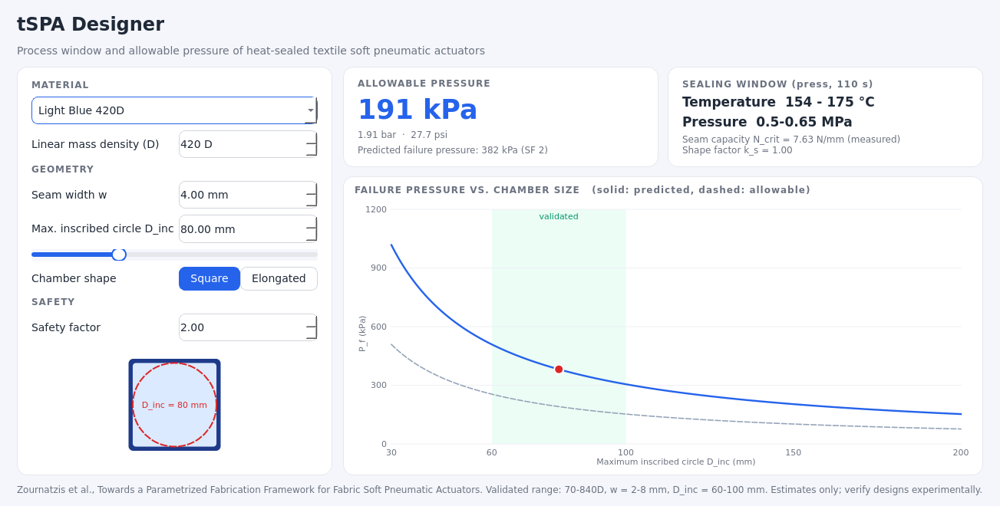

# tSPA fabric materials

Material properties, fabrication windows and design models for **heat-sealed textile soft pneumatic actuators (tSPAs)** made from TPU-coated woven nylon.

This repository is the supplementary material (Online Resource 1) of:

> Zournatzis I., Tsitzira K., Geladaris A., Chatziathanasiou G., Chachamis E., Polygerinos P. *Towards a Parametrized Fabrication Framework for Fabric Soft Pneumatic Actuators.* Intelligent Service Robotics (submitted).

Dataset DOI: [10.5281/zenodo.24117859](https://doi.org/10.5281/zenodo.24117859) (see `CITATION.cff`)

---

## Contents

| Path | Description |
|---|---|
| `data/fabrics.csv` | The 13 TPU-coated nylon fabrics: identifier, linear mass density (Denier and g/m), coated sides, nominal thickness (where measured) |
| `data/uniaxial_summary.csv` | Elastic modulus, ultimate tensile strength and strain at failure along warp (0°), weft (90°) and bias (45°); mean ± SD per fabric and direction, normally 3 specimens (see `n_specimens`) (ISO 527-1/-3) |
| `data/uniaxial_specimens.csv` | Per-specimen uniaxial results (110 specimens): elastic modulus, yield stress, UTS and strain at UTS for each fabric and direction |
| `data/peel_results.csv` | Box-Behnken peel screening (ISO 11339 T-peel): per batch run, sealing temperature/pressure/time, peel resistance S_p, within-strip CV, bond efficiency η and failure mode (ISO 10365) for 4 fabrics |
| `data/burst_results.csv` | Burst/leak screening of inflatable chambers (Exp. 3.1–3.4): geometry, failure pressure and failure mode for every specimen |
| `data/model_parameters.json` | Fitted response-surface models, process windows, and the line-load structural capacity model with its calibration/validation statistics |
| `fea/abaqus/*.inp` | Abaqus `*ELASTIC, TYPE=LAMINA` material cards for all 13 fabrics |
| `fea/abaqus/lamina_parameters_summary.csv` | Summary of the lamina parameters used in the cards |
| `tools/tspa_designer_gui.py` | **tSPA Designer** desktop app (graphical calculator) |
| `tools/tspa_designer.py` | Command-line version of the calculator (and the model functions used by the app) |
| `tools/build_windows.bat` | Builds the stand-alone Windows executable `tSPA_Designer.exe` |

## Quick start: tSPA Designer



Pick a fabric (or enter the denier of any double-sided TPU-coated nylon), set the seam width, chamber size and shape, and the safety factor. The app shows the sealing window, the predicted and allowable failure pressure, and how the failure pressure changes with chamber size.

- **Windows, no installation:** download `tSPA_Designer.exe` from the *Releases* page and double-click it.
- **Run from source (any OS):** `pip install pyside6`, then `python tools/tspa_designer_gui.py`.
- **Build the .exe yourself (Windows):** double-click `tools/build_windows.bat`; the file is written to `tools/dist/`. The GitHub workflow `.github/workflows/build-exe.yml` builds it automatically for every release.

### Command-line version

Requires Python ≥ 3.8 (standard library only).

```bash
# tested fabric
python tools/tspa_designer.py --fabric "Light Blue 420D" --w 4 --dinc 80
# any double-sided TPU-coated nylon between 210D and 840D (interpolation laws)
python tools/tspa_designer.py --denier 300 --w 4 --dinc 60 --elongated --sf 2
```

Arguments: `--w` seam width [mm], `--dinc` maximum inscribed circle of the chamber [mm], `--elongated` for chambers with aspect ratio ≥ 2, `--sf` safety factor.

## Models

**Process window** (press sealing, dwell time 110 s): seal at T_s ≥ T_min and P_c ≥ P_min.
For double-sided fabrics between 210D and 840D:
`T_min ≈ 154 − 7.6·log2(λ_m/420) °C`, `T_s ≤ 175 °C`, `P_min = 0.6 MPa (≤ 300D) or 0.5 MPa`.

**Structural capacity** (continuous perimeter seams):

```
P_f = 4·N_crit·φ_w(w) / (k_s·D_inc),   φ_w(w) = (1 − e^(−k·w)) / (1 − e^(−4k))
```

with k = 1.05 mm⁻¹ (critical seam width ≈ 2.9 mm), k_s = 1 (square) or 1.19 (elongated), and N_crit from `model_parameters.json` or, for double-sided fabrics between 210D and 840D, `N_crit ≈ 7.6·(λ_m/420)^0.46 N/mm`.
Calibrated on 33 specimens (R² = 0.84); validated on an independent geometry within 2.3 %.

**Validity:** 70–840D, w = 2–8 mm, D_inc = 60–100 mm, press-sealed within the process window. Internal spot-weld grids fail at ≈ 2 N/mm and should be avoided unless cells are smaller than D_inc ≈ 20 mm.

## Important notes on the FEA cards

- Direction 1 = warp, 2 = weft. Units: MPa, mm.
- E1, E2 and the bias modulus E45 are **measured**. The in-plane Poisson's ratio **ν12 = 0.30 is assumed** (typical of coated woven fabrics); **G12 is derived** from the bias modulus, `1/G12 = 4/E45 − 1/E1 − 1/E2 + 2ν12/E1`, and therefore depends on the assumed ν12. G13 = G23 = G12 are placeholders (irrelevant for membrane models).
- The response was approximately linear up to near failure; the cards describe linear-elastic orthotropic behavior only.
- Weft properties of **Yellow 210D** and **Light Brown 600D** are **estimated** (no valid weft test data); they are flagged in `data/uniaxial_summary.csv` (`source` column) and in the card headers.
- Thickness was measured only for Navy Blue 70D, Red Lipstick 210D, Light Blue 420D and Blue 840D.

## Data notes

- Processed results are provided; raw measurement files (force–displacement, stress–strain and pressure logs) are available from the corresponding author on reasonable request.
- `uniaxial_specimens.csv` lists every valid specimen; `uniaxial_summary.csv` gives their mean ± SD.
- Lemon Curry 30D bias: 2 valid specimens. Yellow 210D and Light Brown 600D weft: no valid specimens; summary values are estimated and flagged.
- `peel_results.csv`: the raw files of Navy 70D batch 12 and Red 210D batch 15 were unrecoverable; their failure mode was classified from photographs and numerical values are left empty.
- `burst_results.csv`: failure is defined as the first loss of pressure integrity (burst or audible leak with a clear pressure drop); `P_f` is the peak pressure preceding that drop. Fitting failures are labelled separately.
- Navy Blue 70D is single-sided coated and substrate-limited; it is excluded from the double-sided interpolation laws.

## License

Data: CC BY 4.0. Code: MIT. See `LICENSE`.

## Funding

Supported in part by Bendabl PC and by the European Union through the TUBERS (101070115), ARISE (101135959), SWAG (101120408) and POWERS projects.
